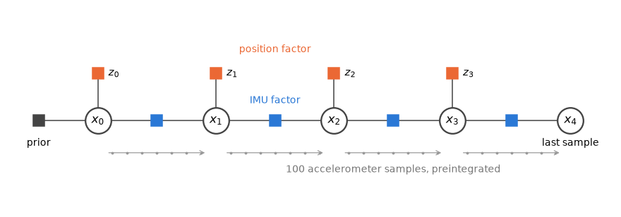
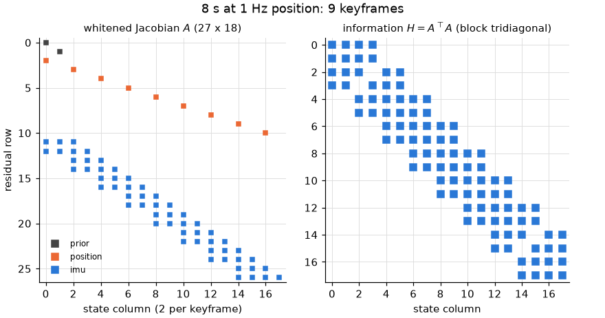
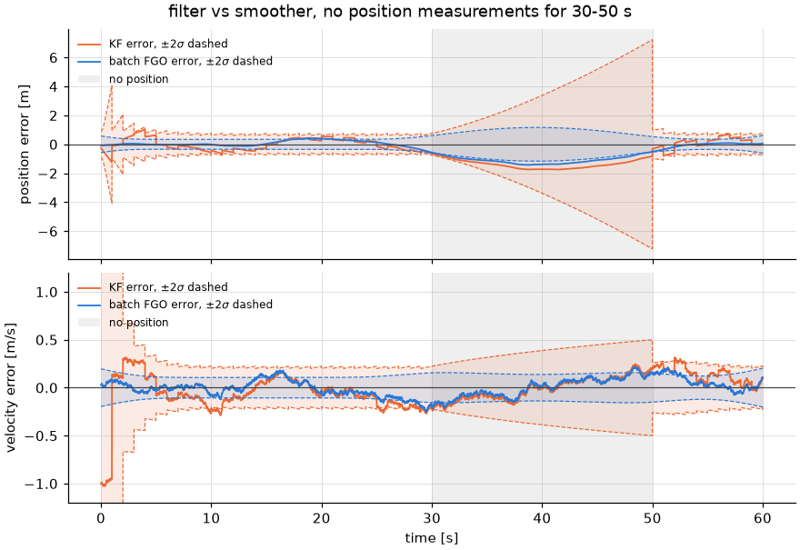
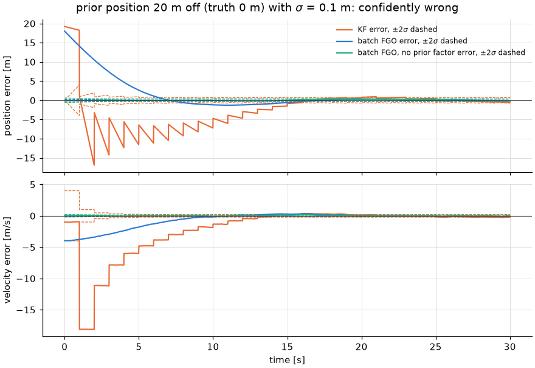
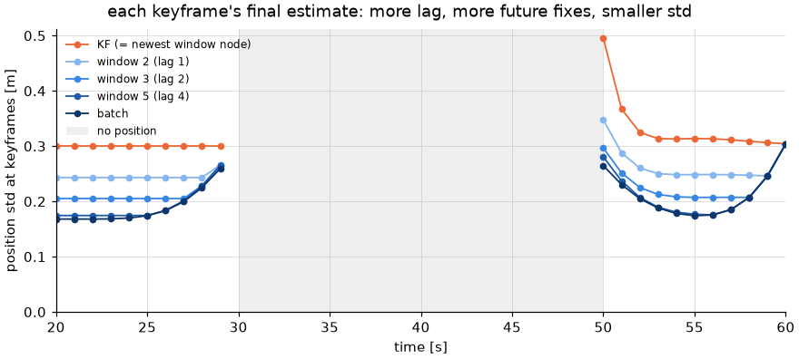

# Factor graph optimization (FGO) for the 1D IMU + position problem

This document explains [`fgo.py`](../fgo.py): the same estimation problem as
[`kf_1d_imu.md`](kf_1d_imu.md) (accelerometer at 100 Hz as input, position at
1 Hz), solved as a **factor graph** instead of a recursive filter. Read that
document first. The model, the simulator and the notation ($F$, $B$,
$\sigma_d$, $q = N_a^2$, $\sigma_p$) are the same here.

The 1D model is linear and Gaussian, which makes it a good place to learn FGO.
Every step can be checked against something exact:

- **Batch FGO equals the RTS smoother** (section 6), to about $10^{-11}$.
- **Sliding-window FGO's newest node equals the Kalman filter** (section 8), to about $10^{-13}$.

In later, nonlinear problems these identities no longer hold. There the
differences between FGO and the filter come from relinearization and from
choices about what to keep in the window.

| File | Contents |
|---|---|
| [`fgo.py`](../fgo.py) | factors, `FactorGraph`, `run_batch_fgo`, `marginalize`, `run_sliding_window_fgo`, `interpolate_segment` |
| [`kf.py`](../kf.py) | `rts_smooth`, the reference for the batch solution |
| [`make_fgo_doc_figures.py`](../make_fgo_doc_figures.py) | regenerates every figure and table in this document |
| [`tests/linear_kf/test_imu_1d_fgo.py`](../../../tests/linear_kf/test_imu_1d_fgo.py) | the exactness checks quoted below |

```bash
# from the repository root
uv run python -m linear_kf.imu_1d.make_fgo_doc_figures   # rewrites doc/fgo_*.png, prints the numbers in sections 7-9 (incl. 7.1)
uv run pytest tests/linear_kf/test_imu_1d_fgo.py
```

```python
from linear_kf.imu_1d.fgo import run_batch_fgo, run_sliding_window_fgo

args = (sim.t, sim.acc_meas, sim.pos_meas, cfg.accel_noise_std, cfg.pos_noise_std, x0, P0)  # same as run_filter
batch = run_batch_fgo(*args)                    # .x (N, 2), .P (N, 2, 2) at the IMU rate, like FilterResult
window = run_sliding_window_fgo(*args, window=5)
```

## 1. From filter to optimization

The Kalman filter answers: *given the measurements so far, what is the state now?*
FGO answers: *given all the measurements, what are all the states?* It does this
by writing down the joint posterior of every state and maximizing it.

With states $\mathbf{x}_0, \dots, \mathbf{x}_K$, the model of `kf_1d_imu.md` §1
factorizes the posterior into one term per piece of information:

$$
p(\mathbf{x}_{0:K} \mid \text{data}) \;\propto\;
\underbrace{p(\mathbf{x}_0)}_{\text{prior}}
\prod_i \underbrace{p(z_i \mid \mathbf{x}_i)}_{\text{position}}
\prod_i \underbrace{p(\mathbf{x}_{i+1} \mid \mathbf{x}_i, a^m)}_{\text{IMU}} .
$$

Each term is a **factor**. Draw each state as a node and each factor as a
square connected to the nodes it involves, and you get the factor graph (Fig. 1).
Every factor is Gaussian, so its negative log is a squared residual weighted
by the inverse covariance. Maximizing the posterior is therefore a
**least-squares problem**:

$$
\hat{\mathbf{x}}_{0:K} = \arg\min \;
\|\mathbf{x}_0 - \hat{\mathbf{x}}_0\|^2_{P_0}
+ \sum_i \|p_i - z_i\|^2_{\sigma_p^2}
+ \sum_i \|\mathbf{x}_{i+1} - F_{i,i+1}\mathbf{x}_i - \boldsymbol{\delta}_{i,i+1}\|^2_{\Sigma_{i,i+1}},
\qquad \|\mathbf{r}\|^2_{\Sigma} = \mathbf{r}^\top\Sigma^{-1}\mathbf{r}.
$$



*Fig. 1: The keyframe factor graph. Circles are state nodes; squares are factors.
Each IMU factor summarizes the accelerometer samples between two keyframes.*

## 2. Nodes: keyframes, not IMU samples

One node per IMU sample would mean 6001 nodes and 12 002 unknowns for 60 s. A
dense solve of that needs a 1.2 GB matrix. Most of those nodes carry no
information of their own, because the only thing between two position fixes is the IMU chain.

So `keyframe_indices` puts a node only at:

- every position fix,
- the first IMU sample (where the prior lives), and
- the last IMU sample (so the graph covers the whole run, as `run_filter` does).

The default run has 61 keyframes and 122 unknowns. During an outage there are no
keyframes, and one IMU factor spans the whole gap (section 7).

Removing the in-between nodes loses nothing. They are linked only by the IMU
chain, and marginalizing (integrating out) a chain of linear-Gaussian
prediction steps gives exactly one Gaussian factor between its ends. That
factor is the preintegrated IMU factor of the next section. Section 5 recovers
the in-between states afterwards.

## 3. Factors

### 3.1 IMU factor: preintegration

From keyframe $i$ (IMU sample $i$) to keyframe $j$, compose the zero-order-hold
steps $\mathbf{x}_{k+1} = F_k\mathbf{x}_k + B_k a^m_k - B_k n_k$:

$$
\mathbf{x}_j = F_{ij}\,\mathbf{x}_i + \boldsymbol{\delta}_{ij} + \mathbf{w}_{ij},
\qquad \mathbf{w}_{ij} \sim \mathcal{N}(0, \Sigma_{ij}).
$$

`preintegrate_cumulative` builds the three terms with the same recursion as the KF prediction:

$$
F \leftarrow F_k F, \qquad
\boldsymbol{\delta} \leftarrow F_k\boldsymbol{\delta} + B_k a^m_k, \qquad
\Sigma \leftarrow F_k \Sigma F_k^\top + \sigma_d^2 B_k B_k^\top,
$$

starting from $(I, \mathbf{0}, 0)$. For $T = t_j - t_i$:

- $F_{ij} = \begin{bmatrix} 1 & T \\ 0 & 1 \end{bmatrix}$.
- $\boldsymbol{\delta}_{ij}$ is the position and velocity change that the accelerometer alone
  would produce starting from rest at the origin.
- $\Sigma_{ij}$ is `predict`'s covariance growth over the interval, starting from $P = 0$.
  For many steps it is close to the continuous-time
  $q\begin{bmatrix} T^3/3 & T^2/2 \\ T^2/2 & T \end{bmatrix}$ of `process_noise.md`.

So "preintegration" here is just the KF prediction composed over the interval,
done once before the solve and kept as a constant. The test
`test_preintegration_equals_chained_predict` checks that
$F_{ij}\mathbf{x} + \boldsymbol{\delta}_{ij}$ and $F_{ij}PF_{ij}^\top + \Sigma_{ij}$
match 253 chained `predict` calls to $10^{-12}$.

In 3D with rotation, the increment depends on the start orientation and bias.
The point of real IMU preintegration (Forster et al.) is to write it so that it
does not have to be recomputed when those estimates change. In this linear 1D
case nothing changes, so the factor is simply exact.

**Why keyframes must be at least 2 samples apart.** One step's noise
$\sigma_d^2 B B^\top$ has rank 1 (`kf_1d_imu.md` §1.3). The factor's residual
is weighted by $\Sigma^{-1}$, which does not exist then. Two or more steps add
noise in different directions ($B_k$ is rotated by $F$), and $\Sigma_{ij}$
becomes positive definite. `keyframe_indices` raises a `ValueError` if fixes
are closer than that.

The residual and its Jacobians are

$$
\mathbf{r}_{ij} = \mathbf{x}_j - F_{ij}\mathbf{x}_i - \boldsymbol{\delta}_{ij}, \qquad
\frac{\partial\mathbf{r}}{\partial\mathbf{x}_i} = -F_{ij}, \qquad
\frac{\partial\mathbf{r}}{\partial\mathbf{x}_j} = I .
$$

### 3.2 Position and prior factors

$$
r^{\text{pos}}_i = p_i - z_i, \quad \frac{\partial r}{\partial \mathbf{x}_i} = H = \begin{bmatrix} 1 & 0 \end{bmatrix}, \quad \text{cov } \sigma_p^2;
\qquad
\mathbf{r}^{\text{prior}} = \mathbf{x}_0 - \hat{\mathbf{x}}_0, \quad \text{Jacobian } I, \quad \text{cov } P_0 .
$$

The prior is the same $(\hat{\mathbf{x}}_0, P_0)$ that `run_filter` starts from.
Without it, the graph would have no information about velocity at $t_0$
beyond what the fixes imply, and could not be compared with the filter.

## 4. Solving: whitening and the normal equations

**Whitening.** Each factor has its own covariance. Multiplying its residual by
$L_f = \operatorname{chol}(\Sigma_f)^{-1}$ (`Factor.sqrt_info`, with
$L_f^\top L_f = \Sigma_f^{-1}$) turns every term into an ordinary squared norm:
$\|\mathbf{r}_f\|^2_{\Sigma_f} = \|L_f\mathbf{r}_f\|^2$.

**Stacking.** `FactorGraph.linearize` puts the whitened Jacobians into one
matrix $A$, with one block row per factor and two columns per node, and the
whitened residuals into one vector $\mathbf{r}$. The cost is $\|\mathbf{r}(\mathbf{x})\|^2$.

**Gauss–Newton.** Linearize at $\mathbf{x}$ and minimize
$\|\mathbf{r} + A\,\delta\mathbf{x}\|^2$ over the step:

$$
\underbrace{A^\top A}_{H}\,\delta\mathbf{x} = -A^\top\mathbf{r}, \qquad \mathbf{x} \leftarrow \mathbf{x} + \delta\mathbf{x}.
$$

Every factor here is linear, so $\mathbf{r}(\mathbf{x} + \delta\mathbf{x}) =
\mathbf{r} + A\,\delta\mathbf{x}$ holds exactly. One iteration from *any*
starting point lands on the minimum (`FactorGraph.solve(iterations=1)`).
In a nonlinear problem you would iterate, and the starting point would matter.

**Covariance.** For a linear-Gaussian model the posterior is exactly
$\mathcal{N}(\hat{\mathbf{x}}, H^{-1})$. $H$ is the **information matrix**,
and the marginal covariance of node $i$ is its $2\times2$ diagonal block of
$H^{-1}$ (`GraphSolution.marginal`). `solve` factors $H = LL^\top$ (Cholesky) and
forms $H^{-1} = L^{-\top}L^{-1}$.



*Fig. 2: Non-zero pattern of $A$ and $H$ for an 8 s run (9 keyframes). Each
position factor touches one node and each IMU factor two adjacent nodes, so
$H$ is block tridiagonal.*

**Sparsity.** A factor couples only the nodes it touches, so $H_{ab} \ne 0$
only if some factor involves both $a$ and $b$. With a chain of IMU factors,
$H$ is block tridiagonal (Fig. 2). The dense solve in `fgo.py` costs
$O(K^3)$, which is fine for $K = 61$. A banded Cholesky would cost $O(K)$.
Section 6 shows that this banded elimination *is* the Kalman filter plus the RTS backward pass.

**Consistency check: $\chi^2$.** At the optimum, the cost
$\|\mathbf{r}(\hat{\mathbf{x}})\|^2$ is $\chi^2$-distributed with
$m - n$ degrees of freedom if the model is right (`GraphSolution.chi2`, `.dof`).
The default run has $m = 2 + 61 + 2\cdot60 = 183$ residual rows and
$n = 2\cdot61 = 122$ unknowns, so dof = 61. This is the batch counterpart of the filter's NIS.
In section 9, the mean $\chi^2/\text{dof}$ over 50 seeds is 0.97.

## 5. Back to the IMU rate: interpolation between keyframes

The solution gives $\hat{\mathbf{x}}$ and $H^{-1}$ at the keyframes only. To
compare with the filter at every IMU sample, `interpolate_segment` recovers
the samples between keyframes $i$ and $j$.

Between them, the IMU chain is the only information, so a sample $m$ depends on
the rest of the data only through $(\mathbf{x}_i, \mathbf{x}_j)$. Given $\mathbf{x}_i$:

- $\mathbf{x}_m = F_{im}\mathbf{x}_i + \boldsymbol{\delta}_{im} + \mathbf{w}_{im}$
  (preintegrate from $i$ to $m$);
- $\mathbf{x}_j = F_{mj}\mathbf{x}_m + \dots$ with $F_{mj} = F_{ij}F_{im}^{-1}$,
  so $\operatorname{Cov}(\mathbf{x}_m, \mathbf{x}_j \mid \mathbf{x}_i) = \Sigma_{im}F_{mj}^\top$.

Conditioning this Gaussian on $\mathbf{x}_j$ gives a **Gaussian bridge**:

$$
K_m = \Sigma_{im}F_{mj}^\top\Sigma_{ij}^{-1}, \qquad
\mathbf{x}_m = F_{im}\mathbf{x}_i + \boldsymbol{\delta}_{im} + K_m\,(\mathbf{x}_j - F_{ij}\mathbf{x}_i - \boldsymbol{\delta}_{ij}) .
$$

Read it as: dead-reckon from $\mathbf{x}_i$, then spread the misfit at $\mathbf{x}_j$
back over the interval with weight $K_m$, which goes from 0 at $i$ to $I$ at $j$.

As a linear map, $\mathbf{x}_m = G_m[\mathbf{x}_i; \mathbf{x}_j] + \mathbf{c}_m$
with $G_m = [F_{im} - K_mF_{ij},\; K_m]$. The keyframe pair has joint covariance
$C_{ij}$ (a $4\times4$ block of $H^{-1}$), so

$$
P_m = G_m\,C_{ij}\,G_m^\top + (\Sigma_{im} - K_mF_{mj}\Sigma_{im}).
$$

The first term is the keyframes' uncertainty carried in. The second is the
bridge's own uncertainty: zero at both ends, largest in the middle.

This needs the **joint** covariance of the two keyframes, not just their
marginals. That is why `GraphSolution` keeps the whole $H^{-1}$.

## 6. Why batch FGO equals the RTS smoother

For a linear-Gaussian model, $p(\mathbf{x}_k \mid \text{all data})$ is a
Gaussian with one mean and one covariance. Any correct algorithm must return
those same two numbers. The RTS smoother (`kf.rts_smooth`) computes them with a
forward KF pass and a backward correction:

$$
C_k = P_{k|k}F^\top P_{k+1|k}^{-1}, \quad
\hat{\mathbf{x}}_{k|N} = \hat{\mathbf{x}}_{k|k} + C_k(\hat{\mathbf{x}}_{k+1|N} - \hat{\mathbf{x}}_{k+1|k}), \quad
P_{k|N} = P_{k|k} + C_k(P_{k+1|N} - P_{k+1|k})C_k^\top .
$$

Batch FGO computes them by solving $H\hat{\mathbf{x}} = \dots$ and inverting $H$.
`test_batch_fgo_equals_rts_smoother` checks three cases (default, `stop_and_go`
with an outage, 10 Hz fixes with an unmodelled bias). Both agree at every IMU
sample, to about $10^{-11}$ in the mean and $10^{-13}$ in the covariance. The
bias case is included on purpose: equality is a property of the algebra, not of the model being right.

The two are closer than "same answer" suggests. Eliminate the nodes of the
block-tridiagonal $H$ one at a time from the left (block Cholesky). Each
elimination step folds everything known about node $k$ into a prior on node
$k+1$, which is exactly a KF predict + update. The last node's marginal after
the forward sweep is the KF posterior. Back-substitution from the right is the
RTS backward pass. **The Kalman filter is a forward sweep of sparse
elimination on the factor graph**, which is the bridge to section 8.

Two consequences:

- The **last** node of the batch solution equals the KF posterior at the last
  sample (checked in the same test), because no data lies beyond it.
- The **first** node is better than the KF's: it has seen 60 s of future fixes.

## 7. Results: filter vs smoother



*Fig. 3: Error and $\pm2\sigma$ of the KF (orange) and batch FGO (blue) on the
same data, with no position fixes for 30–50 s. The velocity axis is clipped;
the KF starts with a 1 m/s velocity error.*

**Away from the outage.** Steady-state position std (outage-free run, 30–31 s):

| | at a fix | halfway | just before the next fix | velocity std |
|---|---|---|---|---|
| KF | 0.300 m | 0.336 m | 0.375 m | 0.100 m/s |
| batch FGO | 0.167 m | 0.167 m | 0.167 m | 0.053 m/s |

The KF has its sawtooth (`kf_1d_imu.md` Fig. 3). The smoother's std is flat:
the dip at each fix is about $10^{-8}$ m. Each fix has σ = 0.5 m, and the
IMU links neighbouring fixes with only $\sqrt{qT^3/3} \approx 0.03$ m of
noise per second. Every fix within a few seconds on *either* side is therefore
almost as informative about time $t$ as the fix at $t$ itself. The smoother
effectively averages about $(0.5/0.167)^2 \approx 9$ fixes, roughly the KF's
"past" plus an equal "future". Near the ends of the run only one side exists,
and the std rises: 0.287 m at $t = 0$ and 0.300 m at 60 s. The latter equals
the KF there, as section 6 says it must.

**Across the outage.** The KF dead-reckons and its std grows to 3.61 m just
before fixes return at 50 s. Then it snaps back. The smoother knows where the
vehicle was at both 30 s *and* 50 s. One IMU factor spans the whole gap, and the
interpolation of section 5 is a Gaussian bridge between the two ends. The
std peaks near the middle, at 0.58 m (t = 39.5 s), about
6 times smaller than the KF's worst. The error curve has no jump at
50 s: the smoother spreads the correction over the whole outage.

This is the practical reason to smooth when you can wait. Post-processed
trajectories (survey, mapping, ground truth for evaluating a filter) are
smoothed. A real-time controller can only use the filter.

### 7.1 A wrong prior

Both estimators start from the prior $(\hat{\mathbf{x}}_0, P_0)$. What happens
when its mean is wrong? Here the prior puts the start 20 m away from the truth
(truth $p_0 = 0$). The velocity prior stays at the default $0 \pm 2$ m/s, and
the truth is 1 m/s. The prior's position σ takes three values.

**The prior is not the initial guess.** These are two different things:

- The **prior** is a factor. It is information in the cost $J$, and changing it changes the answer.
- The **initial guess** is only where Gauss–Newton starts (section 4).
  `run_batch_fgo` starts every node at zero. Because the factors are linear,
  a random start with σ = 1000 m gives the same solution to about $10^{-10}$.

This section is about the prior.

| prior σ | | error at 0 s | 1 s | 5 s | 10 s | max \|vel err\| | prior's influence gone after | first NIS / $\chi^2$ |
|---|---|---|---|---|---|---|---|---|
| 30 m (honest) | KF | −0.33 | −0.11 | −0.01 | −0.42 | 1.03 m/s | 0 s | 0.46 |
| | FGO | −0.08 | −0.03 | −0.01 | −0.01 | 0.18 m/s | 0 s | 60 / 61 |
| 1 m | KF | 3.73 | 0.12 | −0.81 | −0.83 | 3.50 m/s | 15 s | 331 |
| | FGO | 1.58 | 1.26 | 0.23 | −0.12 | 0.36 m/s | 12 s | 429 / 61 |
| 0.1 m | KF | 19.22 | 1.03 | −6.42 | −4.71 | 18.15 m/s | 27 s | 1590 |
| | FGO | 17.99 | 14.09 | 2.62 | −1.19 | 3.99 m/s | 19 s | 4089 / 61 |

*Position errors in metres, default `sine` run, seed 0. "Influence gone"
is the time after which the estimate stays within 0.1 m of the honest-prior run.*



*Fig. 4: Error and $\pm2\sigma$ with the prior 20 m off and σ = 0.1 m: KF
(orange), batch FGO (blue), and batch FGO with the prior factor removed (green).*

**An honest prior does no harm.** With σ = 30 m, the first fix (σ = 0.5 m)
carries about 3600 times more weight than the prior. The result is within
0.1 m of a run with a correct prior from $t = 0$ on.

**A confidently wrong prior misleads both, but only for a while.** Both
estimators compute the exact posterior of the model they are given, and that
model says the start is at $20 \pm 0.1$ m. Neither diverges, though. The
prior's information is fixed, while the fixes keep adding more. The KF
forgets the prior after 15 s (σ = 1 m) or 27 s (σ = 0.1 m); FGO after 12 s or 19 s.
Until then both are overconfident: at the start the error is about 190–200 times
their own σ.

**The two go wrong in different ways** (Fig. 4):

- **The KF can only explain the conflict with velocity.**
  - The first update has gain $0.1^2/(0.1^2 + 0.5^2) = 0.04$, so the estimate stays 19.2 m off.
  - The velocity prior (σ = 2 m/s) lets the predicted position spread to about
    2 m in one second. The fix at 1 s therefore gets a gain of about 0.94 and is believed.
  - Having seen only the past, the filter concludes that the vehicle *moved*
    19 m in that second. Its velocity error jumps to −18 m/s.
  - What follows is a large sawtooth: it dead-reckons with the wrong velocity,
    each fix pulls it back, and the swings are visible for about 15 s.
- **FGO fits one trajectory to all the fixes at once.**
  - The IMU factors tightly constrain *changes* in velocity
    ($\sqrt{q\,T} = 0.05$ m/s per second) but not the velocity itself.
  - The cheapest compromise between the prior and the fixes is therefore a
    smooth curve: a velocity offset of about −4 m/s that decays over ~10 s.
  - It accepts misfitting the first few fixes by metres rather than
    contradicting the IMU, so there is no sawtooth and no velocity spike.
  - The price is a larger error right after the start: 14 m at 1 s, against the KF's 1 m.

**Both can detect it.** Under a correct model, the KF's first NIS is about 1
and FGO's $\chi^2$ is about its degrees of freedom (61, with a 99.9 %
quantile near 100). Here they are 1590 and 4089. A wrong prior is not hidden
at all; it just has to be checked for.

**Remedies.**

- **KF:** start from the first fix, $\hat p_0 = z_0$ with $\sigma = \sigma_p$, or use a wide $P_0$.
  A large first NIS is a reason to reinitialize.
- **FGO: drop the prior factor.** Every keyframe has a position factor, and
  the IMU factors link them, so the fixes alone determine position *and*
  velocity. $H$ stays positive definite without the prior. The green curve in
  Fig. 4 is that solve:
  - Node 0 is off by −0.085 m and 0.034 m/s, with σ = 0.300 m and 0.100 m/s.
  - $\chi^2$ = 58.8 with 59 degrees of freedom (the prior's 2 rows are gone).
  - The whole trajectory stays within 0.007 m of the honest-prior solution.

  A KF cannot do this, because it must start from *some* $(\hat{\mathbf{x}}_0, P_0)$.
  The prior is truly needed only when some state is unobservable from the
  other factors. Absolute yaw with only visual odometry is one example (see
  [`visual_odometry.md`](../../../imu_gnss_ekf_training/doc/visual_odometry.md) §7).
  There, the prior fixes that free direction.

In a linear model all of this is a transient. In a nonlinear one it can be
permanent. A wrong start can make an EKF linearize around the wrong state, for
example with heading off by 180°, and it may never recover. FGO has the same
risk through its initial guess, but it can relinearize and revisit the start
when more data arrives. A filter cannot.

## 8. Sliding-window FGO and marginalization

Batch FGO grows with the run and only answers at the end. A real-time
estimator keeps a **window** of the most recent `window` keyframes.
`run_sliding_window_fgo`:

```text
for each new keyframe g:
    add node g, its IMU factor from g-1, its position factor (if any)
    solve the active window                      -> x_online[g] (the newest node)
    if the window is full:
        record the oldest node (x_key, P_key) and interpolate its segment
        marginalize the oldest node              -> a MarginalFactor on its neighbours
```

### 8.1 Marginalization: the Schur complement

You cannot just delete the oldest node and its factors. They hold
information about the remaining nodes (the prior, old fixes, the IMU link to
the next node). Marginalizing keeps that information while removing the
variable. Take the factors touching node $m$, linearize them, and order the
unknowns as $[\mathbf{x}_m; \mathbf{x}_k]$, with $\mathbf{x}_k$ the nodes they also touch:

$$
\begin{bmatrix} H_{mm} & H_{mk} \\ H_{km} & H_{kk} \end{bmatrix}
\begin{bmatrix} \delta\mathbf{x}_m \\ \delta\mathbf{x}_k \end{bmatrix}
= -\begin{bmatrix} \mathbf{g}_m \\ \mathbf{g}_k \end{bmatrix}.
$$

Solving the first row for $\delta\mathbf{x}_m$ and substituting gives a
system in $\delta\mathbf{x}_k$ alone:

$$
H' = H_{kk} - H_{km}H_{mm}^{-1}H_{mk}, \qquad
\mathbf{g}' = \mathbf{g}_k - H_{km}H_{mm}^{-1}\mathbf{g}_m .
$$

$H'$ is the **Schur complement**. For Gaussians this is exact marginalization:
the information about $\mathbf{x}_k$, with $\mathbf{x}_m$ integrated out.

`marginalize` turns $(H', \mathbf{g}')$ back into a factor so the window solve
treats it like any other. With $H' = LL^\top$ and $\mathbf{d} = \mathbf{x}_k - \mathbf{x}_k^{\text{lin}}$,

$$
\mathbf{r}^{\text{marg}} = L^\top\mathbf{d} + L^{-1}\mathbf{g}'
\quad\Rightarrow\quad
\|\mathbf{r}^{\text{marg}}\|^2 = \mathbf{d}^\top H'\mathbf{d} + 2\,\mathbf{g}'^\top\mathbf{d} + \text{const},
$$

which is the `MarginalFactor`. It is already whitened (covariance $I$), and
its Jacobian $L^\top$ is fixed at the linearization point $\mathbf{x}^{\text{lin}}$.

**Fill-in.** The new factor connects *all* of $\mathbf{x}_k$ to each other. In the
chain here, the oldest node touches only the next one, so the marginal prior is
a $2\times2$ factor on one node. Marginalizing an inner node instead (as
`test_marginalizing_a_node_keeps_the_joint_marginal_of_the_rest` does) creates
a dense factor linking its two neighbours. In bigger graphs, such as landmarks
seen from many poses, fill-in is what makes marginalization expensive. It is
why real systems choose carefully what to marginalize and what to simply drop.

**Exact here, approximate in general.** Every factor is linear, so the Hessian
does not depend on the linearization point, and the frozen Jacobian is no
approximation. `test_sliding_window_equals_batch_on_the_data_seen_so_far`
checks that every window solve equals batch FGO on the data up to its newest
keyframe, to $10^{-9}$. In a nonlinear problem the marginal prior stays
linearized at $\mathbf{x}^{\text{lin}}$ while the rest of the window
relinearizes. The prior and the factors can then disagree about what is
observable. This is the same overconfidence the 2D EKF shows for yaw
([`visual_odometry.md`](../../../imu_gnss_ekf_training/doc/visual_odometry.md) §7), and first-estimate
Jacobians (FEJ) are the usual fix.

### 8.2 What the window size buys

- **The newest node is the KF.** It has seen exactly the data up to now, like
  the filter. `test_sliding_window_newest_node_is_the_kf_and_full_window_is_batch`
  checks `x_online` against `run_filter` at every keyframe, to $10^{-13}$.
  The window does not make the *current* estimate better. It improves the
  *recent past*.
- **Older nodes are fixed-lag smoothed.** A node's final estimate (`x_key`) is
  from the last solve that held it, when it had `window − 1` keyframes of future data.
- **A window that covers every keyframe** never marginalizes, and equals batch FGO.



*Fig. 5: Each keyframe's final position std, for the KF, windows of 2, 3 and 5
keyframes, and batch. Same outage data as Fig. 3.*

Two things stand out in Fig. 5:

- **Lag helps quickly, then saturates.** One keyframe of lag (window 2) already
  closes about 40 % of the gap between the KF and batch (position RMSE 0.341 →
  0.271 m, batch 0.169 m, section 9). Four keyframes of lag (window 5) get
  position to within about 6 % of batch; velocity converges more slowly (18 %). This matches section 7: the smoother's
  information comes from a few seconds on each side.
- **The window counts keyframes, not seconds.** The node at 29 s gets the
  benefit of the fix at 50 s with a window of only 2. During the outage there
  are no keyframes, so the next keyframe *is* the 50 s fix. A window defined by
  time would need more than 20 s to see across the outage.

## 9. Monte Carlo summary

`make_fgo_doc_figures.py`, 50 seeds, metrics over $t \ge 5$ s (as in
`kf_1d_imu.md` §5). "sigma" is the RMS of each estimator's own std. Window
rows are the fixed-lag estimates at the IMU rate.

| case | estimator | pos RMSE [m] | pos sigma [m] | vel RMSE [m/s] | vel sigma [m/s] |
|---|---|---|---|---|---|
| sine | KF | 0.341 | 0.341 | 0.110 | 0.107 |
| sine | window 2 | 0.271 | 0.272 | 0.097 | 0.095 |
| sine | window 3 | 0.222 | 0.225 | 0.083 | 0.083 |
| sine | window 5 | 0.179 | 0.182 | 0.065 | 0.065 |
| sine | batch FGO | 0.169 | 0.172 | 0.055 | 0.055 |
| sine, outage 30–50 s | KF | 1.212 | 1.253 | 0.156 | 0.148 |
| sine, outage 30–50 s | window 2 | 0.382 | 0.405 | 0.094 | 0.095 |
| sine, outage 30–50 s | window 3 | 0.350 | 0.375 | 0.084 | 0.086 |
| sine, outage 30–50 s | window 5 | 0.334 | 0.357 | 0.072 | 0.074 |
| sine, outage 30–50 s | batch FGO | 0.325 | 0.327 | 0.065 | 0.066 |

- Every estimator is consistent: RMSE ≈ sigma. Batch FGO also passes the
  global checks: mean $\chi^2/\text{dof}$ = 0.97 / 0.98 and mean NEES = 1.99 / 2.07 without / with the outage (expected 1 and 2).
- Without an outage, smoothing halves both errors relative to the KF (position
  0.341 → 0.169 m, velocity 0.110 → 0.055 m/s), and the window rows fill in between.
- With the outage, the smoother's advantage grows to 3.7× in position, because
  the dead-reckoned stretch is where the future fix matters most. Most of that
  comes from one keyframe of lag: window 2 already gets 0.38 m, since its next
  keyframe is the fix at 50 s (section 8.2).

## 10. Cost

| | per new keyframe | all at once |
|---|---|---|
| KF | $O(1)$, 100 predicts + 1 update | — |
| sliding window (dense) | $O(W^3)$ solve + $O(W)$ to marginalize | — |
| batch, dense (`fgo.py`) | — | $O(K^3)$ |
| batch, banded / RTS | — | $O(K)$ |

For 61 keyframes everything is fast. The dense $O(K^3)$ is a deliberate choice
for readability: `FactorGraph` shows the whole $A$ and $H$, which you can print and
inspect. The preintegration (100 small matrix products per IMU factor, in
Python) dominates the run time, not the solve.

## 11. Where FGO goes beyond the filter

In this linear model, FGO and the KF/RTS family give identical answers. The
reasons to prefer a graph appear when that stops being true:

- **States the filter cannot keep cheaply.** A constant accelerometer bias is a
  single node connected to every IMU factor ($\partial\boldsymbol{\delta}_{ij}/\partial b = -\sum_k F_{k+1,j}B_k$, with $F_{k+1,j}$ the transition from sample $k+1$ to $j$).
  The filter would carry it in its state forever. This is the fix for
  `kf_1d_imu.md` §8.
- **Robust kernels.** Replace $\|\mathbf{r}\|^2$ by Huber or Cauchy for
  position factors. An outlier fix then gets down-weighted by iteratively
  reweighted least squares (IRLS), and past decisions can be revisited, which
  a filter cannot do.
- **Nonlinear models.** In 2D with heading, the IMU factor depends on the
  orientation. Relinearizing the whole window at each solve is then the
  difference between FGO and an EKF, and marginalization needs FEJ (section 8.1).
